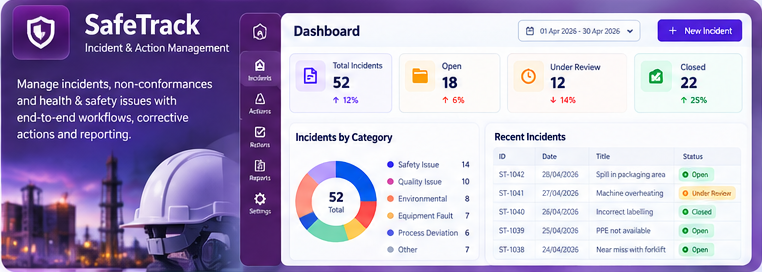
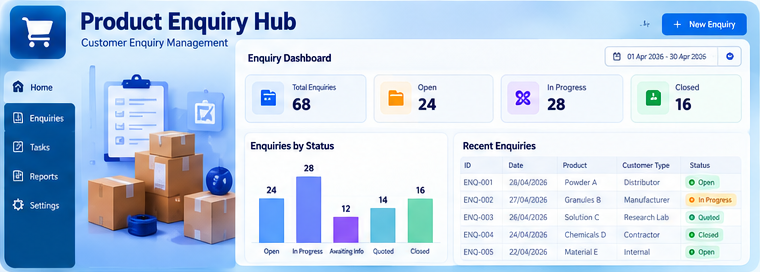
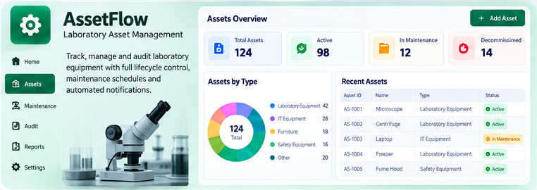
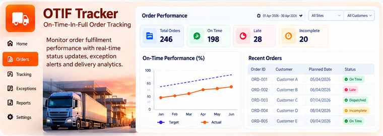
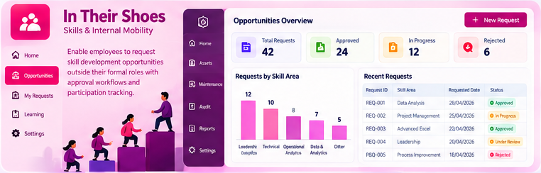
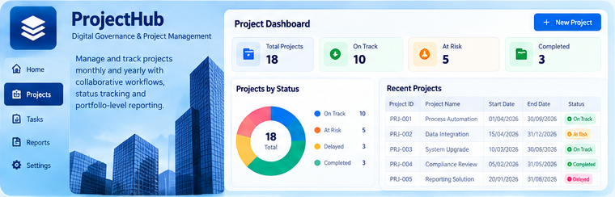
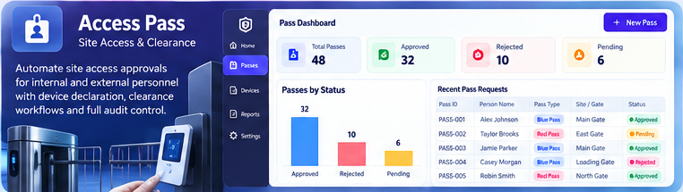
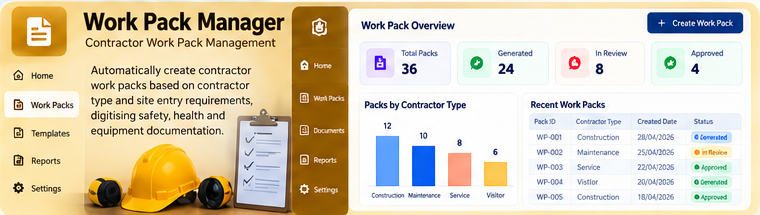

# Hari Arayakeel — Power Platform Solution Architect

End-to-end Microsoft Power Platform developer: Power Apps, Power Automate, Power BI, Dataverse and Dynamics 365.

**Live portfolio:** https://hari-arayakeel.github.io

## Power Platform solutions (selected work)

Illustrative mockups with fictional sample data, recreated to protect confidentiality.

### SafeTrack — Incident & Action Management
Non-compliance ticketing for multiple business units, supporting Rapid Problem Solving and central incident tracking. Role-based workflows, automated email notifications and Power BI reporting.

### Product Enquiry Hub
End-to-end tracking of customer price and quantity enquiries across sales, supply chain, costing, dispensing and packaging, with no manual handovers. Power BI dashboards for volume, response SLAs and bottlenecks.

### AssetFlow — Asset Management
Lifecycle management for laboratory equipment: create, track, audit and retire. Audit workflows, notifications, dashboards and Excel exports.

### OTIF Tracker — Order Fulfilment
On-Time-In-Full order tracking for supply chain teams, with automated status updates, exception alerts, Power BI analytics and Excel exports.

### In Their Shoes — Skills & Mobility
Employees request skill-development opportunities outside their formal role. Automated approvals, manager assignment, participation tracking and reporting.

### ProjectHub — Digital Governance
Jira-style project governance: monthly and yearly tracking, status, collaboration, progress reporting and portfolio visibility in Power BI.

### Access Pass — Site Access & Clearance
Site access for staff and contractors: security approvals, clearance-manager workflows and device declarations, with notifications and audit reporting.

### Work Pack Manager — Contractor Packs
Automatically generates contractor document bundles by contractor type and site-entry requirements, replacing paper-based safety, health and equipment documentation.

## Open source
- [Toastmasters Time Keeper](https://github.com/hari-arayakeel/toastmaster-timekeeper)
- [Time Keeper with Meeting History](https://github.com/hari-arayakeel/timekeeper-with-history)
- [Club Calendar Automation](https://github.com/hari-arayakeel/toastmasters-club-3380-calendar)

## Contact
hari.arayakeel@outlook.com · [LinkedIn](https://www.linkedin.com/in/hari-arayakeel)
